# 便签 · Notes

一个手机便签 App。网页版是**单文件 HTML**，无依赖、无后端、不用构建；安卓版是一个 41 KB 的 WebView 壳，把同一份页面装进去。

数据全部存在本机 `localStorage`，不上传任何服务器。

**[▸ 在线试用](https://mikoi6.github.io/notes-app/)**（手机浏览器打开后可「添加到主屏幕」）　·　**[▸ 下载 APK](https://github.com/mikoi6/notes-app/releases/latest)**

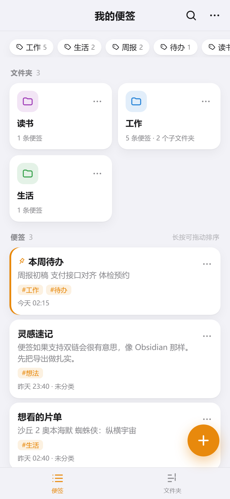

## 功能

### 文件夹：无限层级

2 列卡片浏览，进文件夹后显示子文件夹 + 本层便签。另有一个树视图，用缩进表达完整层级，每行显示**递归**便签数。

| 文件夹内 | 文件夹树 |
| --- | --- |
| 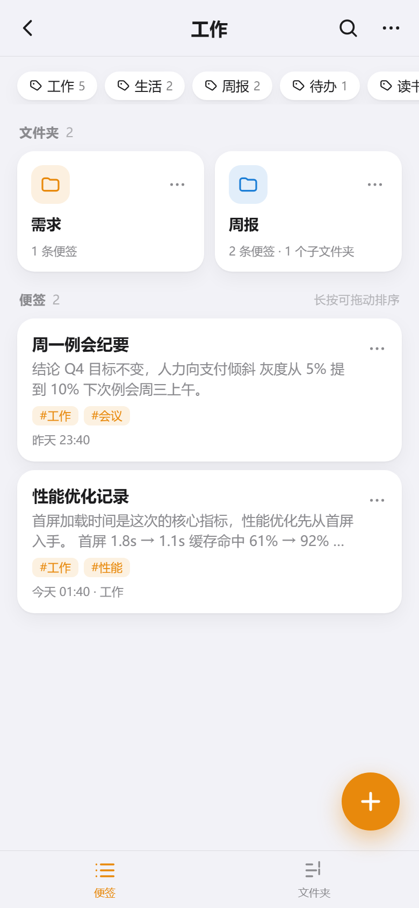 | 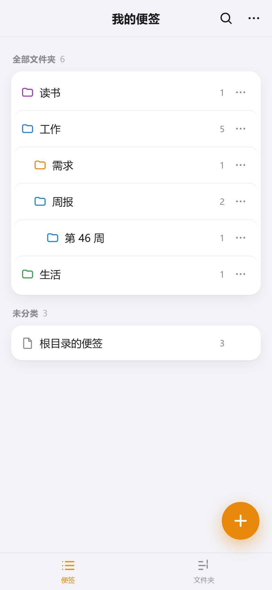 |

- 新建 / 重命名 / 移动 / 删除；删除父级会连子孙一起删，删前告诉你有多少条受牵连
- 移动时自动禁用**自己和自己的所有后代**，防止把子树拖进自己里面把树弄断

数据结构上「无限层级」不需要任何特殊处理 —— 扁平数组 + 单指针：

```js
folder = { id, name, parentId, color, createdAt }   // parentId 为 null 即根目录
note   = { id, folderId, title, content, tags, pinned, order, createdAt, updatedAt }
```

所以「移动文件夹」只是改一个 `parentId`，树视图靠递归渲染出来。

### 目录预览：一眼看全，点哪跳哪

文件夹页顶部有一条「目录」，点开把**当前文件夹下所有层级**的文件夹和便签铺成一份大纲：

- 顺序是「先列这一层的便签，再展开子文件夹」。这不是随手定的 —— 反过来写（先递归完所有子文件夹、再列本层便签）会让「文件夹 A 的便签」漂到「文件夹 A 的子文件夹」后面，读起来像孙子
- 文件夹行带彩色图标和深度便签数，空文件夹标「空」；便签行是淡色小圆点，没标题写「无标题」，置顶的换成小图钉
- 点文件夹进入该文件夹，点便签直接打开编辑器；跳转后目录保持展开，可以连着跳
- 层级过深时缩进封顶在 8 层，长名字不会被挤成几个字
- 安卓返回键先收起目录，再退上一级

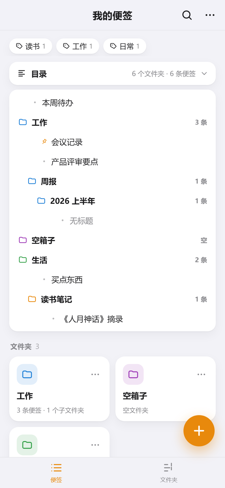

### 标签、置顶、拖拽排序

- 标签支持逗号批量输入（`工作, 紧急` 一次建两个），卡片上前 3 个可见，多的折叠成 `+N`
- 顶部标签条是全库统计的，点任意标签跳到**跨文件夹**的筛选视图
- 长按卡片约 0.4 秒进入拖拽，卡片浮起、其它卡片让位、松手保存

排序优先级是 **置顶 > 手动顺序 > 最近更新**。把普通便签拖到置顶便签上方，松手后会弹回置顶组下面 —— 这是有意的，置顶就该永远在最前。

### 搜索：列表级 + 便签内

列表搜索同时匹配标题、正文、标签，结果里的关键词高亮，而且**摘要是从命中处截取的**（前后各留一点上下文），不是永远从正文开头截一段。

| 搜索结果 | 便签内查找 |
| --- | --- |
|  | 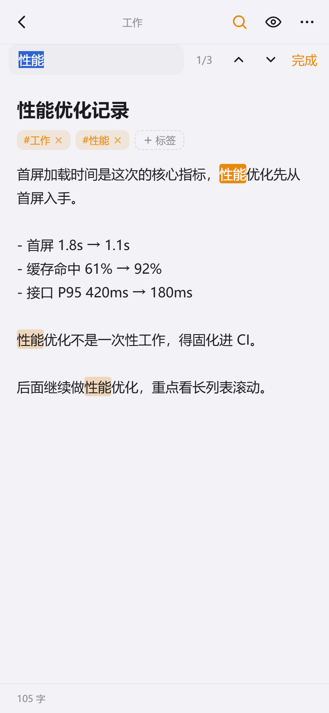 |

便签内查找这里有个技术限制：`<textarea>` 自身无法给部分文字加高亮。做法是进入查找时，把正文换成一层**只读高亮视图**，字号、行高、左右内边距、`white-space: pre-wrap` 都与正文完全对齐，所以切换时看不出跳动。当前命中是实心橙底，右侧显示 `2/3` 进度，上下箭头循环跳转；点「完成」回到编辑，**光标停在刚才那个命中上**，可以直接改。

### Markdown

编辑器边写边预览，右上角眼睛图标切换。解析器是手写的（约 90 行，无依赖），支持标题、有序/无序列表、引用、代码块、行内代码、粗斜体、删除线、链接、分割线。**先转义再解析**，XSS 用例验证过。

| 编辑 | 预览 |
| --- | --- |
| 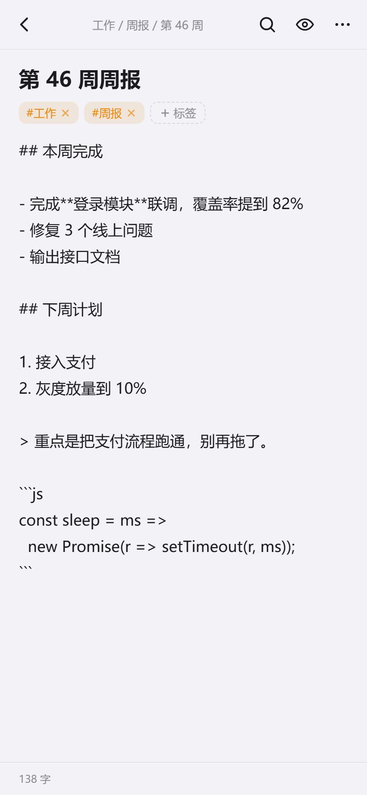 | 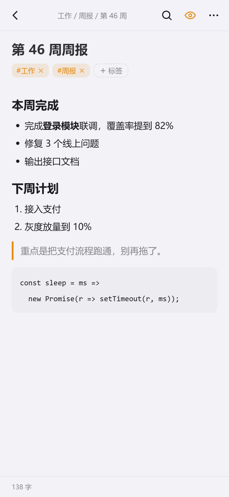 |

### 导出：四种形态

右上角 `⋯` → 导出与备份。

| 形态 | 说明 |
| --- | --- |
| 单条便签 | TXT / Markdown / HTML，HTML 会把正文渲染成排版（适合直接发给别人） |
| 全量单文件 | TXT / Markdown / HTML，多用于存档和打印 |
| **按文件夹结构** | 一条便签一个文件，目录层级照搬，见下 |
| JSON 备份 | 完整数据，可导回来（id 重映射后合并，不覆盖现有数据） |

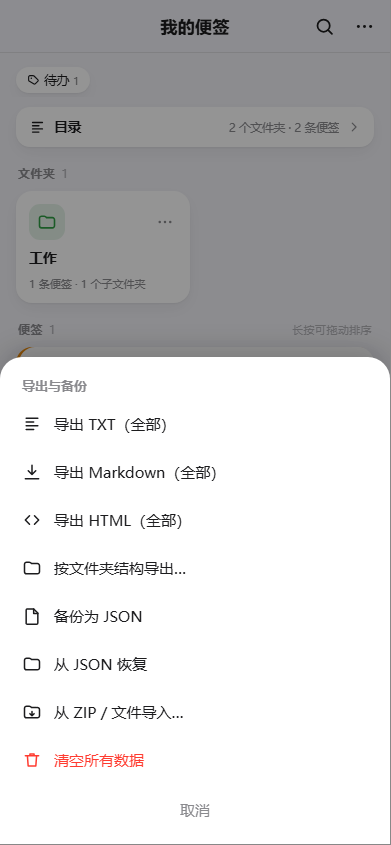

「按文件夹结构」导出的结果：

```
便签-20261112-0238/
├── 本周待办.md
└── 工作/
    ├── 性能优化记录.md
    ├── 空壳/                        ← 空文件夹也保留
    └── 周报/
        └── 第 46 周/
            └── 第 46 周周报.md
```

- **正文就是便签正文**，不重复写标题、不塞「位置：工作 / 周报」——目录本身就是位置。只有正文里没有一级标题时才补一个 `# 标题`
- 文件修改时间 = 便签最后编辑时间，解压后按时间排序就是你的时间线
- 同目录重名自动变 `重名 (2).md`；文件夹名里的 `/ : * ?` 替换成 `_`（不清洗的话，叫「工作/周报」的文件夹会被拆成两层）

投递有两条路径：**安卓上直接建真实目录**（写进 `下载/便签-…/工作/周报/`，文件管理器点进去就是多层文件夹）；**浏览器上打包成 ZIP**。ZIP 是手写编码器（约 90 行，仅存储不压缩），关键点是给文件名打 UTF-8 标记位，否则中文名解压会变乱码。

### 外观与便签皮肤

**外观**在主菜单 `⋯` → 外观，三种：跟随系统 / 浅色 / 深色。选择存在 `localStorage`，下次打开还是你选的那个。首屏有一段内联脚本先把 `data-theme` 定好，所以不会先白后黑闪一下。

实现上没有维护两套颜色：深色就是 `:root[data-theme="dark"]` 覆盖同一组 CSS 变量，跟随系统与外选手动在 JS 里先归一成 `light`/`dark` 再写属性。

**便签皮肤**是每条便签独立的，编辑器右上角 `⋯` → 背景皮肤，六种纯色（默认 / 米黄 / 薄荷 / 樱粉 / 天青 / 沙褐）。点一下立刻生效，面板不关，可以来回试。皮肤同时作用在编辑器整页和列表卡片上，所以在列表里也能一眼认出哪条设了皮肤。

做法是给元素挂 `data-skin`，在 CSS 里覆盖 `--bg`、`--surface`、`--text` 等变量，子树里所有组件自动跟着变，不用逐个写样式。浅色主题和深色主题各配一套（深色下是低明度纸色）。

有一个坑值得记：CSS 变量只影响**显式写了 `var(--x)` 的属性**，而文字颜色是继承来的 —— 只覆盖变量，`<input>` 里的字仍是父级算好的旧颜色。所以挂皮肤的根节点要额外补一句 `color:var(--text)`，让继承链从这一层重新取色。

| 米黄皮肤 | 皮肤选择 |
| --- | --- |
| 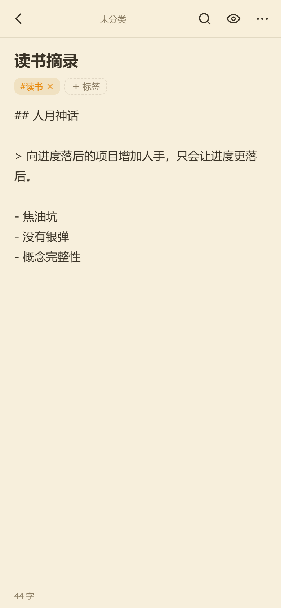 | 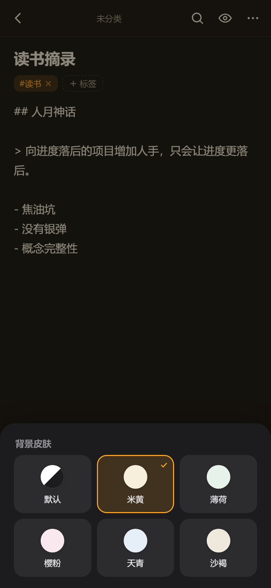 |

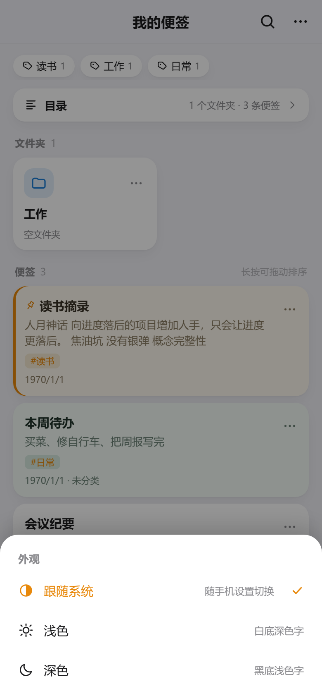

### 深色模式

跟随系统或手动指定，见上面的「外观与便签皮肤」。

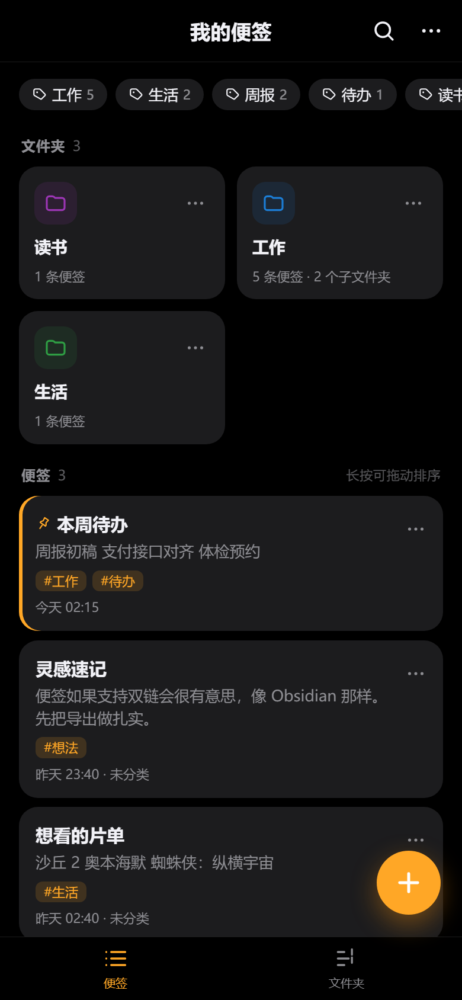

## 安卓版怎么做的

没有用 Capacitor / Cordova，手写了一个纯 Java 的 WebView 壳，不依赖 androidx，所以 APK 只有 41 KB。

三个值得说的点：

**1. 不用 `file:///android_asset`，改用虚拟域名。** `shouldInterceptRequest` 把 `https://notes.local/` 映射到 assets。原因是 `file://` 协议下 `localStorage` 在不同 WebView 版本行为不一致，而 `https://notes.local` 的 origin 稳定，数据不会莫名其妙消失。

**2. 导出走原生通道。** WebView 里 `<a download>` 基本没用，所以 JS 检测到 `AndroidBridge` 就把内容交给原生：单文件用 `MediaStore` 写「下载/便签」，目录树则逐个 insert、中间目录由 MediaStore 自动带出来（Android 10+）；Android 8/9 退回应用私有目录 + `mkdirs`。

**3. 返回键交给网页。** 按返回键时调 `androidBack()`，页面依次关弹窗 → 关查找 → 关编辑器 → 退搜索 → 退标签筛选 → 回上级文件夹，都处理完了才退出 App。

`minSdk 26`（Android 8.0+），`targetSdk 34`，图标是 vector 画的便签纸，没有 PNG。

## 目录结构

```
.
├── index.html                 网页版，同时也作为 APK 里的页面
├── 便签.apk                   已构建好的安装包
├── build-apk.sh               改完页面后一键重打包
├── screenshots/               README 用的截图
└── android/
    ├── app/src/main/
    │   ├── java/com/notes/app/MainActivity.java   WebView 壳 + JS 桥 + 文件写入
    │   ├── assets/index.html                      构建时自动从根目录同步
    │   └── res/                                   图标、主题
    ├── build.gradle
    └── settings.gradle
```

## 本地运行

网页版不需要任何环境：

```bash
# 方式一：直接双击 index.html
# 方式二：起个静态服务（推荐，某些浏览器对 file:// 的 localStorage 有限制）
python -m http.server 8000
```

## 重新打包 APK

`build-apk.sh` 会把根目录的 `index.html` 同步进 `android/app/src/main/assets/` 再构建，输出覆盖根目录的 `便签.apk`。

脚本不依赖仓库内的任何工具链目录，直接从本机环境探测，需要这三样：

| 需要 | 说明 |
| --- | --- |
| JDK 17+ | 必须是完整 JDK（带 `jlink`）。JRE、JetBrains JBR 这类精简运行时会在 `JdkImageTransform` 报错 |
| Android SDK | 含 `platforms;android-34` 与 `build-tools;34.0.0`，用 `sdkmanager` 装 |
| Gradle 8.7+ | 命令行 `gradle`，或 `~/.gradle/wrapper/dists` 里已下载的发行版（脚本会挑版本最高的） |

探测顺序：`JAVA_HOME` / `ANDROID_HOME` 环境变量 → 常见安装路径（`C:\Program Files\Java\jdk-*`、`~/AndroidBuild/sdk`、`~/AppData/Local/Android/Sdk`）。找不到会直接说明缺哪一样，不会静默失败。

构建完成后脚本会解出 APK 里的 `assets/index.html` 和根目录那份比 md5，不一致就报错 —— 避免"改了页面但打进旧版"。

**版本号只有一处真源**：`index.html` 里的 `const APP_VERSION`。`build.gradle` 的 `versionName` 必须与它一致，打 APK 时脚本会先对账，不一致直接中止；如果当前提交已经打了 tag，tag 名去掉 `v` 也要等于它，否则给出警告。这样页面「关于」里显示的版本、APK 的版本、GitHub 的 tag 永远是同一个数。

**签名**：仓库里不放签名密钥（`android/keystore/`、`*.jks` 都在 `.gitignore` 里）。自己生成一个：

```bash
keytool -genkeypair -v -keystore android/keystore/notes.jks \
  -alias notes -keyalg RSA -keysize 2048 -validity 10000
```

生成后把密码填进 `android/app/build.gradle` 的 `signingConfigs.release`（当前是硬编码的占位值）。注意签名变了，手机上要先卸载旧版才能装新版。

## 已知限制

- **数据在 `localStorage`**，换浏览器、清缓存、换设备都会丢。请在 `⋯` → 备份为 JSON 里定期导出
- **Android 10+ 无法只创建一个空文件夹**，只能靠写入文件顺带带出来。所以按文件夹结构导出时，空的子文件夹会被略过，完成提示里会写明略过了几个
- **APK 未在真机验证过**。构建、签名、lint、页面 md5 一致性都过了，但实际的触感和 WebView 兼容性需要装到手机上确认
- **自签名证书**，只适合自己安装。上应用商店需要正式签名、隐私政策、跟进最新 targetSdk
- 没有云同步。单机应用，这是设计取舍不是遗漏

## 版本

- `v1.2.0` — 外观手动切换（跟随系统 / 浅色 / 深色）、每条便签可选纯色背景皮肤、版本号与 tag 统一
- `v1.1.0` — 目录预览：当前文件夹下所有层级的文件夹与便签铺成大纲，点哪跳哪
- `v1.0.0` — 首个版本：文件夹树、标签、置顶拖拽、Markdown、搜索与查找高亮、单条/全量/按目录导出、JSON 备份、安卓 APK
