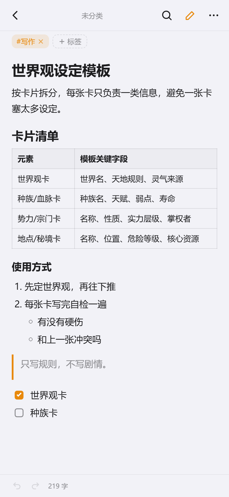
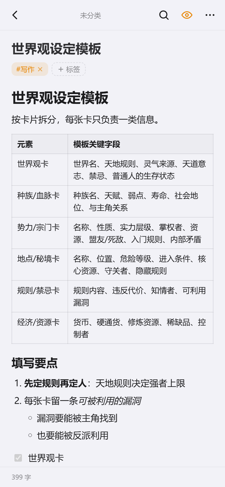
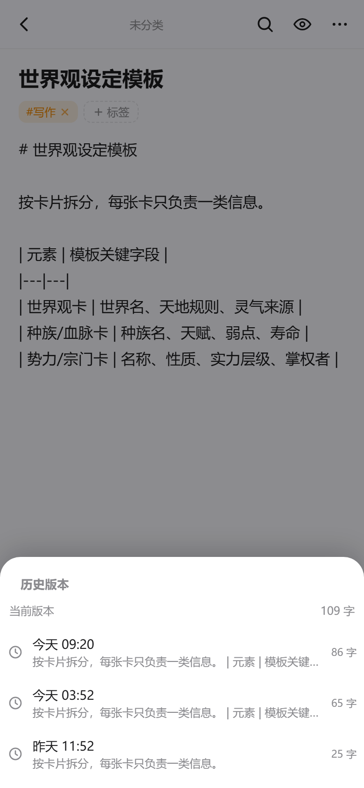
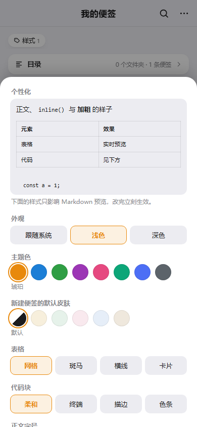
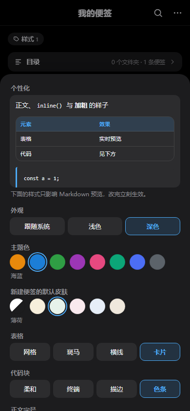
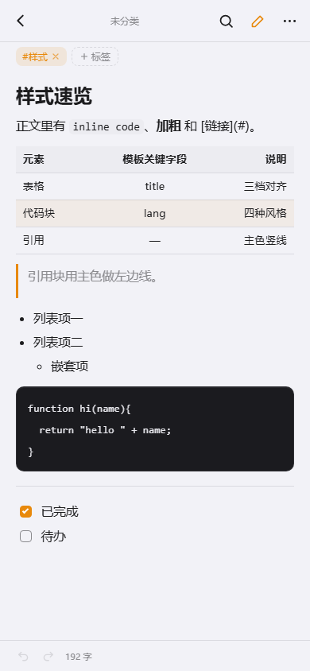
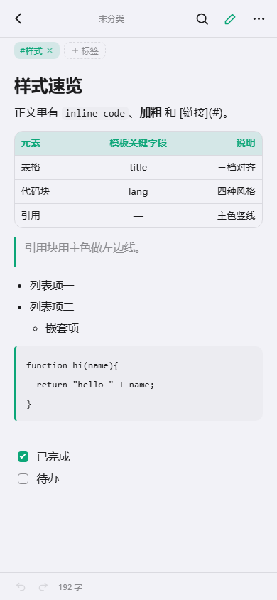

# 便签 · Notes

一个手机便签 App。网页版是**单文件 HTML**，无依赖、无后端、不用构建；安卓版是一个 41 KB 的 WebView 壳，把同一份页面装进去。

数据全部存在本机 `localStorage`，不上传任何服务器。

**[▸ 在线试用](https://mikoi6.github.io/notes-app/)**（手机浏览器打开后可「添加到主屏幕」）　·　**[▸ 下载 APK](https://github.com/mikoi6/notes-app/releases/latest)**


## 功能

### 文件夹：无限层级

2 列卡片浏览，进文件夹后显示子文件夹 + 本层便签。另有一个树视图，用缩进表达完整层级，每行显示**递归**便签数。

| 文件夹内 | 文件夹树 |
| --- | --- |
|  |  |

- 新建 / 重命名 / 移动 / 删除；删除父级会连子孙一起删，删前告诉你有多少条受牵连
- 移动时自动禁用**自己和自己的所有后代**，防止把子树拖进自己里面把树弄断

数据结构上「无限层级」不需要任何特殊处理 —— 扁平数组 + 单指针：

```js
folder = { id, name, parentId, color, createdAt }   // parentId 为 null 即根目录
note   = { id, folderId, title, content, tags, pinned, order, createdAt, updatedAt }
```

所以「移动文件夹」只是改一个 `parentId`，树视图靠递归渲染出来。

### 目录预览：一眼看全，点哪跳哪

文件夹页顶部有一条「目录」，点开把**当前文件夹下所有层级**的文件夹和便签铺成一份大纲：

- 顺序是「先列这一层的便签，再展开子文件夹」。这不是随手定的 —— 反过来写（先递归完所有子文件夹、再列本层便签）会让「文件夹 A 的便签」漂到「文件夹 A 的子文件夹」后面，读起来像孙子
- 文件夹行带彩色图标和深度便签数，空文件夹标「空」；便签行是淡色小圆点，没标题写「无标题」，置顶的换成小图钉
- 点文件夹进入该文件夹，点便签直接打开编辑器；跳转后目录保持展开，可以连着跳
- 层级过深时缩进封顶在 8 层，长名字不会被挤成几个字
- 安卓返回键先收起目录，再退上一级


### 标签、置顶、拖拽排序

- 标签支持逗号批量输入（`工作, 紧急` 一次建两个），卡片上前 3 个可见，多的折叠成 `+N`
- 顶部标签条是全库统计的，点任意标签跳到**跨文件夹**的筛选视图
- 长按卡片约 0.4 秒进入拖拽，卡片浮起、其它卡片让位、松手保存

排序优先级是 **置顶 > 手动顺序 > 最近更新**。把普通便签拖到置顶便签上方，松手后会弹回置顶组下面 —— 这是有意的，置顶就该永远在最前。

### 搜索：列表级 + 便签内

列表搜索同时匹配标题、正文、标签，结果里的关键词高亮，而且**摘要是从命中处截取的**（前后各留一点上下文），不是永远从正文开头截一段。

| 搜索结果 | 便签内查找 |
| --- | --- |
|  |  |

便签内查找这里有个技术限制：`<textarea>` 自身无法给部分文字加高亮。做法是进入查找时，把正文换成一层**只读高亮视图**，字号、行高、左右内边距、`white-space: pre-wrap` 都与正文完全对齐，所以切换时看不出跳动。当前命中是实心橙底，右侧显示 `2/3` 进度，上下箭头循环跳转；点「完成」回到编辑，**光标停在刚才那个命中上**，可以直接改。

### 打开便签：先读，再改

点开一条**已有正文**的便签，直接进预览——回来看的时候多半是"读"，不是"改"。要动手时点右上角：图标在**眼睛 / 铅笔**之间随状态切换，眼睛是切到预览，铅笔是切回编辑。

- 新建、或只有标题还没写正文的便签，仍然从编辑开始，否则打开没处下笔
- 从卡片 `⋯ → 编辑`、`编辑标签`、或从搜索结果点进来，直奔编辑，不绕一趟预览
- 预览与编辑切换时按滚动比例带过位置，读到一半点编辑不会跳回顶部
- 正文第一行如果是 `# 和标题同名` 的大标题，预览时顶部标题栏让开，同一句话不出现两遍



### Markdown

编辑器右上角的图标切换预览。解析器是手写的（约 280 行，无依赖），支持：

- 标题：`#` 式与下划线式（`===` / `---`）
- 列表：有序 / 无序 / 任务列表，可多级嵌套，有序列表保留起始序号
- 表格：GFM 写法，支持 `:---`、`:---:`、`---:` 三种对齐，手机上整块横向滚动
- 引用：内部还能再放列表和表格
- 其它：图片、自动链接（`<url>` 与裸链接）、代码块、行内代码、粗体 / 斜体 / 删除线、分割线、行尾两空格硬换行、反斜杠转义

**先转义再解析**，`<script>` 与 `javascript:` 链接的用例都验证过。表格、图片、任务列表在导出的 HTML 里同样有排版。

| 编辑 | 预览（含表格） |
| --- | --- |
|  |  |

### 撤回与历史版本

底栏左侧是撤回 / 重做，键盘上 `Ctrl+Z` / `Ctrl+Shift+Z`（macOS 用 `⌘`）同样生效。快照按 700ms 节流，撤一次退的是上一段，而不是一个字一个字退。

编辑器的 `⋯ → 历史版本` 能翻到过去的版本，点一下即可恢复：

- 每条便签最多留 **30 个**版本；单条历史总量超过 12 万字符时从最旧的开始丢
- 60 秒内的连续修改合并成一个版本，避免攒出几十个碎片
- 关闭便签时补记一条"这次打开时的样子"，短时间的编辑也不会漏
- 恢复前会把当前内容也存进历史，恢复错了还能再切回来

存储真的不够时，会先丢掉历史版本保住正文，不会因为历史把便签本身写丢。

| 撤回 / 重做 | 历史版本 |
| --- | --- |
|  |  |

### 导出：四种形态

右上角 `⋯` → 导出与备份。

| 形态 | 说明 |
| --- | --- |
| 单条便签 | TXT / Markdown / HTML，HTML 会把正文渲染成排版（适合直接发给别人） |
| 全量单文件 | TXT / Markdown / HTML，多用于存档和打印 |
| **按文件夹结构** | 一条便签一个文件，目录层级照搬，见下 |
| JSON 备份 | 完整数据，可导回来（id 重映射后合并，不覆盖现有数据） |


### 导入：只有 JSON 一条路

`⋯` → 导出与备份 → **从 JSON 恢复**，选一份 `便签备份-*.json` 就行。这是目前唯一的导入入口 —— TXT / Markdown / HTML 是单向出口，导不回来。

导入的行为是**合并**，不是覆盖：

- 每个文件夹、每条便签都重新分配 id，所以同一份备份导两次会得到两份，不会互相顶掉，也不会污染现有数据
- 文件夹的父子关系和便签归属按新旧 id 的映射表重建，层级不会丢
- 便签的标题、正文、标签、置顶、创建时间、**皮肤、历史版本**都按原样恢复；备份里如果混进了不存在的皮肤 id 或缺字段的历史项，会被统一丢掉
- 新便签的 `order` 排在现有数据之后，不会插队
- 导入完自动回到根目录

失败情形只有两种提示：文件不是合法 JSON、或里面没有 `folders` / `notes` 两个数组（不是本应用导出的）。点「取消」则一条都不写入。

> 从 md 文件批量导进来目前不支持。如果你需要，可以把 `notes/*.md` 放进文件夹后一次性变成便签（文件夹名 → 文件夹，文件名 → 标题）—— 说一声就加。

「按文件夹结构」导出的结果：

```
便签-20261112-0238/
├── 本周待办.md
└── 工作/
    ├── 性能优化记录.md
    ├── 空壳/                        ← 空文件夹也保留
    └── 周报/
        └── 第 46 周/
            └── 第 46 周周报.md
```

- **正文就是便签正文**，不重复写标题、不塞「位置：工作 / 周报」——目录本身就是位置。只有正文里没有一级标题时才补一个 `# 标题`
- 文件修改时间 = 便签最后编辑时间，解压后按时间排序就是你的时间线
- 同目录重名自动变 `重名 (2).md`；文件夹名里的 `/ : * ?` 替换成 `_`（不清洗的话，叫「工作/周报」的文件夹会被拆成两层）

投递有两条路径：**安卓上直接建真实目录**（写进 `下载/便签-…/工作/周报/`，文件管理器点进去就是多层文件夹）；**浏览器上打包成 ZIP**。ZIP 是手写编码器（约 90 行，仅存储不压缩），关键点是给文件名打 UTF-8 标记位，否则中文名解压会变乱码。

### 个性化设置：主题色、表格、代码块都能换

主菜单 `⋯` → 个性化设置。面板顶部是一块**实时小样**：表格、代码块、字号、行距随手一改，样片当场就变，不用关掉面板回正文里核对。

| 分组 | 可选项 |
| --- | --- |
| 外观 | 跟随系统 / 浅色 / 深色 |
| 主题色 | 琥珀、海蓝、松绿、葡萄、玫瑰、青碧、靛青、石墨（8 种，深色模式各配一档亮色） |
| 新建便签的默认皮肤 | 默认 / 米黄 / 薄荷 / 樱粉 / 天青 / 沙褐 |
| 表格 | 网格（全边框）/ 斑马（隔行浅色）/ 横线（只留横线 + 主色表头）/ 卡片（外框圆角 + 主色表头） |
| 代码块 | 柔和（浅灰底）/ 终端（深底浅字）/ 描边（透明底）/ 色条（左侧主色竖线） |
| 正文字号 | 小 14.5px / 标准 15.5px / 大 17px |
| 行距 | 紧凑 1.62 / 标准 1.75 / 宽松 1.92 |

底部「恢复默认」一键回到出厂设置。

| 个性化面板 | 深色下的面板 |
| --- | --- |
|  |  |

| 斑马表格 + 终端代码 | 卡片表格 + 色条代码 |
| --- | --- |
|  |  |

实现上延续了主题和皮肤那套思路：**选项全部写成 `<html>` 上的 `data-*` 属性**，CSS 用属性选择器接管。

- 主题色只覆盖 `--accent`、`--accent-rgb`、`--soft` 三个变量，按钮、标签、勾选框、悬浮按钮阴影、搜索高亮全部自动跟随 —— 之前阴影里硬编码的 `rgba(232,137,12,.42)` 都换成了 `rgba(var(--accent-rgb),.42)`
- 字号和行距走 `--md-size` / `--md-lh`，标题字号从 `px` 改成 `em`，放大缩小时标题层级比例才不会走样
- 表格 / 代码块的四档样式只是几组覆盖规则，默认档不写属性，CSS 里「没有属性」就是默认样式
- 设置存在 `localStorage['noteapp.look']`，和主题一样由首屏内联脚本先应用一次，不会先橙后蓝、先网格后斑马地闪一下

### 便签皮肤

每条便签独立配色，编辑器右上角 `⋯` → 背景皮肤，六种纯色（默认 / 米黄 / 薄荷 / 樱粉 / 天青 / 沙褐）。点一下立刻生效，面板不关，可以来回试。皮肤同时作用在编辑器整页和列表卡片上，所以在列表里也能一眼认出哪条设了皮肤。

个性化设置里的「新建便签的默认皮肤」只影响之后新建的便签；已有便签仍在这里单独改。

做法是给元素挂 `data-skin`，在 CSS 里覆盖 `--bg`、`--surface`、`--text` 等变量，子树里所有组件自动跟着变，不用逐个写样式。浅色主题和深色主题各配一套（深色下是低明度纸色）。

有一个坑值得记：CSS 变量只影响**显式写了 `var(--x)` 的属性**，而文字颜色是继承来的 —— 只覆盖变量，`<input>` 里的字仍是父级算好的旧颜色。所以挂皮肤的根节点要额外补一句 `color:var(--text)`，让继承链从这一层重新取色。

| 米黄皮肤 | 皮肤选择 |
| --- | --- |
|  |  |

### 深色模式

跟随系统或手动指定，见上面的「个性化设置」。


## 安卓版怎么做的

没有用 Capacitor / Cordova，手写了一个纯 Java 的 WebView 壳，不依赖 androidx，所以 APK 只有 41 KB。

三个值得说的点：

**1. 不用 `file:///android_asset`，改用虚拟域名。** `shouldInterceptRequest` 把 `https://notes.local/` 映射到 assets。原因是 `file://` 协议下 `localStorage` 在不同 WebView 版本行为不一致，而 `https://notes.local` 的 origin 稳定，数据不会莫名其妙消失。

**2. 导出走原生通道。** WebView 里 `<a download>` 基本没用，所以 JS 检测到 `AndroidBridge` 就把内容交给原生：单文件用 `MediaStore` 写「下载/便签」，目录树则逐个 insert、中间目录由 MediaStore 自动带出来（Android 10+）；Android 8/9 退回应用私有目录 + `mkdirs`。

**3. 返回键交给网页。** 按返回键时调 `androidBack()`，页面依次关弹窗 → 关查找 → 关编辑器 → 退搜索 → 退标签筛选 → 回上级文件夹，都处理完了才退出 App。

`minSdk 26`（Android 8.0+），`targetSdk 34`，图标是 vector 画的便签纸，没有 PNG。

## 目录结构

```
.
├── index.html                 网页版，同时也作为 APK 里的页面
├── 便签.apk                   已构建好的安装包
├── build-apk.sh               改完页面后一键重打包
├── screenshots/               README 用的截图
└── android/
    ├── app/src/main/
    │   ├── java/com/notes/app/MainActivity.java   WebView 壳 + JS 桥 + 文件写入
    │   ├── assets/index.html                      构建时自动从根目录同步
    │   └── res/                                   图标、主题
    ├── build.gradle
    └── settings.gradle
```

## 本地运行

网页版不需要任何环境：

```bash
# 方式一：直接双击 index.html
# 方式二：起个静态服务（推荐，某些浏览器对 file:// 的 localStorage 有限制）
python -m http.server 8000
```

## 重新打包 APK

`build-apk.sh` 会把根目录的 `index.html` 同步进 `android/app/src/main/assets/` 再构建，输出覆盖根目录的 `便签.apk`。

脚本不依赖仓库内的任何工具链目录，直接从本机环境探测，需要这三样：

| 需要 | 说明 |
| --- | --- |
| JDK 17+ | 必须是完整 JDK（带 `jlink`）。JRE、JetBrains JBR 这类精简运行时会在 `JdkImageTransform` 报错 |
| Android SDK | 含 `platforms;android-34` 与 `build-tools;34.0.0`，用 `sdkmanager` 装 |
| Gradle 8.7+ | 命令行 `gradle`，或 `~/.gradle/wrapper/dists` 里已下载的发行版（脚本会挑版本最高的） |

探测顺序：`JAVA_HOME` / `ANDROID_HOME` 环境变量 → 常见安装路径（`C:\Program Files\Java\jdk-*`、`~/AndroidBuild/sdk`、`~/AppData/Local/Android/Sdk`）。找不到会直接说明缺哪一样，不会静默失败。

构建完成后脚本会解出 APK 里的 `assets/index.html` 和根目录那份比 md5，不一致就报错 —— 避免"改了页面但打进旧版"。

**版本号只有一处真源**：`index.html` 里的 `const APP_VERSION`。`build.gradle` 的 `versionName` 必须与它一致，打 APK 时脚本会先对账，不一致直接中止；如果当前提交已经打了 tag，tag 名去掉 `v` 也要等于它，否则给出警告。这样页面「关于」里显示的版本、APK 的版本、GitHub 的 tag 永远是同一个数。

**签名**：仓库里不放签名密钥（`android/keystore/`、`*.jks` 都在 `.gitignore` 里）。自己生成一个：

```bash
keytool -genkeypair -v -keystore android/keystore/notes.jks \
  -alias notes -keyalg RSA -keysize 2048 -validity 10000
```

生成后把密码填进 `android/app/build.gradle` 的 `signingConfigs.release`（当前是硬编码的占位值）。注意签名变了，手机上要先卸载旧版才能装新版。

## 已知限制

- **数据在 `localStorage`**，换浏览器、清缓存、换设备都会丢。请在 `⋯` → 备份为 JSON 里定期导出
- **Android 10+ 无法只创建一个空文件夹**，只能靠写入文件顺带带出来。所以按文件夹结构导出时，空的子文件夹会被略过，完成提示里会写明略过了几个
- **APK 未在真机验证过**。构建、签名、lint、页面 md5 一致性都过了，但实际的触感和 WebView 兼容性需要装到手机上确认
- **自签名证书**，只适合自己安装。上应用商店需要正式签名、隐私政策、跟进最新 targetSdk
- 没有云同步。单机应用，这是设计取舍不是遗漏

## 版本

- `v1.6.0` — 个性化设置：8 种主题色、4 种表格样式、4 种代码块样式、字号与行距各 3 档、新建便签默认皮肤，面板带实时小样
- `v1.5.0` — 打开已有正文的便签直接进预览，右上角眼睛 / 铅笔切换；切换时保留阅读位置；标题不再重复
- `v1.4.0` — 便签内撤回 / 重做（按钮与快捷键）、历史版本回溯与恢复
- `v1.3.0` — Markdown 预览补全：表格（含对齐）、多级 / 任务列表、图片、自动链接、下划线式标题、硬换行
- `v1.2.0` — 外观手动切换（跟随系统 / 浅色 / 深色）、每条便签可选纯色背景皮肤、版本号与 tag 统一
- `v1.1.0` — 目录预览：当前文件夹下所有层级的文件夹与便签铺成大纲，点哪跳哪
- `v1.0.0` — 首个版本：文件夹树、标签、置顶拖拽、Markdown、搜索与查找高亮、单条/全量/按目录导出、JSON 备份、安卓 APK
